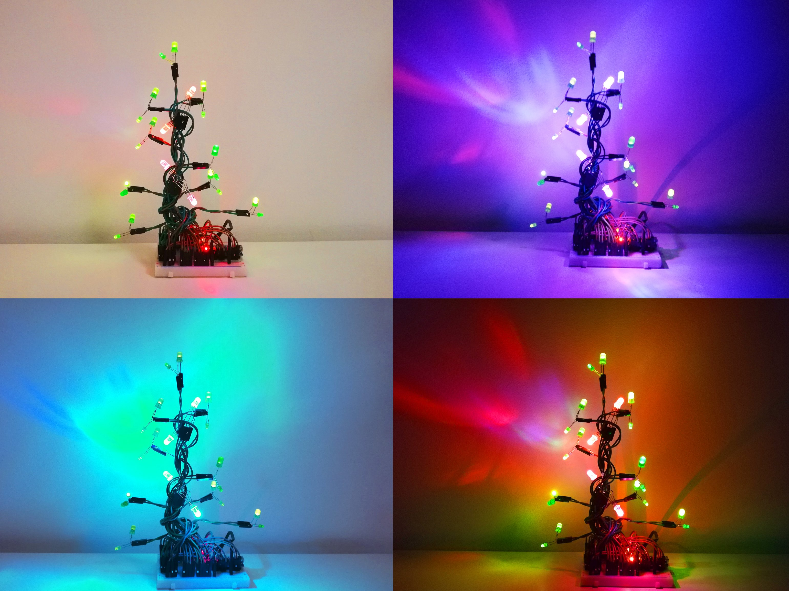
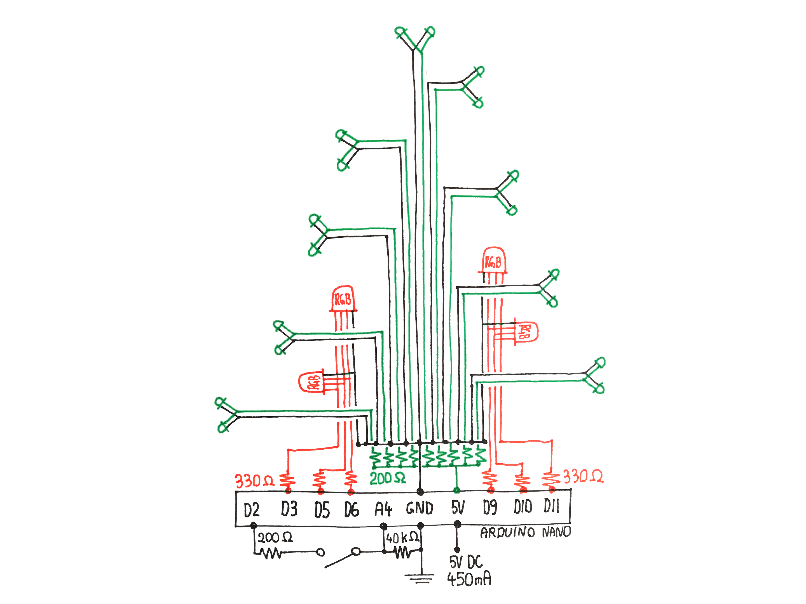

# Simple Arduino Christmas Tree

Still don't have a Christmas tree? Don't panic! Grab an Arduino, some jumper wires and let's do it!

I saw many Arduino-based Christmas decorations. Most of them focused mainly on hiding the jumper wires as well as possible. Why do it, though? Can't the wires be the core of the project? In my tree you don't need to hide anything: the wires are the branches and roots of the tree. The Arduino could be a neat gift hiding underneath!

The project is really easy to follow. Just check out the wiring diagram and the [tutorial video on YouTube](https://youtu.be/YGjODarvENA).

## Repository contents

| Path | Contents |
|---|---|
| [`christmas_tree/christmas_tree.ino`](christmas_tree/christmas_tree.ino) | Arduino code |
| [`images/wiring_diagram.jpg`](images/wiring_diagram.jpg) | Wiring diagram |

## Parts

- Arduino Nano
- Breadboard
- 18× 5 mm green LED
- 4× RGB LED, common cathode
- 6× 330 Ω resistor
- 10× 200 Ω resistor
- 1× 40 kΩ resistor
- Tactile switch
- 5 V 2.5 A switching power supply
- 26 jumper wires

## Wiring

| Arduino pin | Connected to |
|---|---|
| D2 | Button (interrupt) |
| A4 | 5 V supply for the button |
| D6, D3, D5 | RGB LEDs, group 1 (red, green, blue) |
| D11, D9, D10 | RGB LEDs, group 2 (red, green, blue) |

## Animations

Press the button to switch between the three animations:

1. **Night mode**: static; dims the RGB lights to match the green LEDs.
2. **Swipe**: swipes through different colors.
3. **Fire flicker**: my personal favourite.

## Links

- [Arduino Project Hub](https://projecthub.arduino.cc/bzqp/simple-christmas-tree-f37052)

## License

Simple Arduino Christmas Tree by bzqp is licensed under the [Creative Commons Attribution-NonCommercial 4.0 International](https://creativecommons.org/licenses/by-nc/4.0/) license (CC BY-NC 4.0). See [LICENSE](LICENSE).
